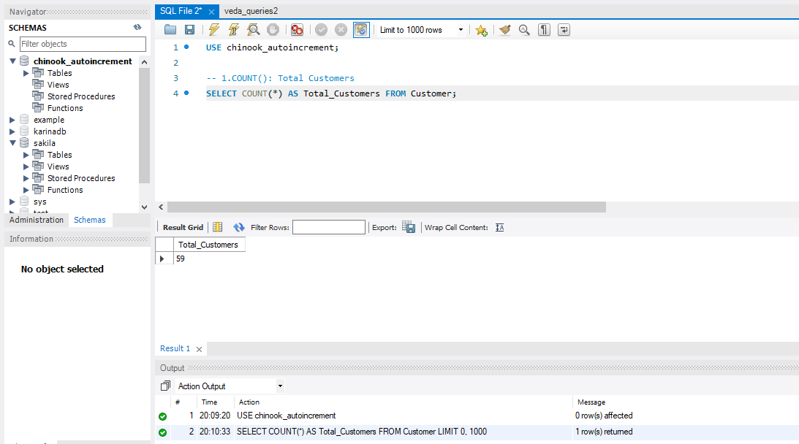
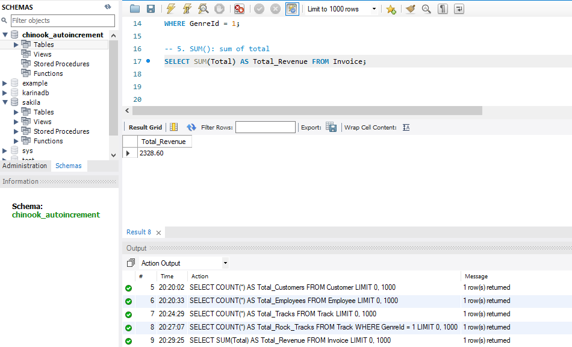
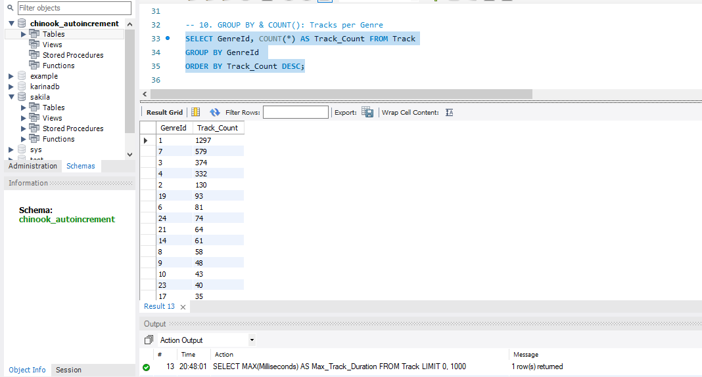

## SQL Aggregation Basics (Chinook Database, MySQL)

## Overview
10 SQL queries that practice aggregation functions (COUNT, SUM, AVG, MIN, MAX) and GROUP BY on the Chinook sample database (a digital music store) in MySQL Workbench.

## Files
- veda_queries3.sql: all 10 queries
- outputs/: screenshot of each query result (query1.png to query10.png)

## Setup
- Database: Chinook (Chinook_MySql_AutoIncrementPKs.sql, version 1.4.5)
- Tool: MySQL Workbench with MySQL 8.0
- I used the Chinook database to practice and analyze aggregate metrics.

## Queries and results
| # | What it does | Function / Clause used |
|---|---|---|
| 1 | Total customers count | COUNT(*) |
| 2 | Total employees count | COUNT(*) |
| 3 | Total tracks count | COUNT(*) |
| 4 | Total rock tracks count | COUNT() with WHERE |
| 5 | Total revenue from invoices | SUM() |
| 6 | Total sales in USA | SUM() with WHERE |
| 7 | Average track price | AVG() |
| 8 | Minimum track price | MIN() |
| 9 | Maximum track duration (ms) | MAX() |
| 10 | Track count per genre | GROUP BY with COUNT() |

## Sample outputs
Query 1 (COUNT Total Customers)

Query 5 (SUM Total Revenue)

Query 10 (GROUP BY Track Count per Genre)

The screenshots of all queries are in the [outputs folder](outputs).

## What I learned
- `COUNT()` is used to count the number of rows or records in a table or group.
- `SUM()` calculates the total sum of a numerical column, and `AVG()` computes the average while automatically ignoring `NULL` values.
- `MIN()` and `MAX()` find the lowest and highest values in a dataset.
- `GROUP BY` is essential when we want to organize and apply aggregate functions across specific categories or groups.
